# Models, dependencies and business rules

Reference for the Django models in `backend/base/models/`. It describes what exists today. Every model lives in the `base` app. Field names are
Spanish; money is in euros.

How to read the rules: each one says where it is enforced.
**DB** = database constraint, **model** = validator or `clean()`, **admin** = Django admin form,
**API** = serializer or view, **seed** = loaded by the seed tool, **command** = management command.

Contents: 1 Overview · 2 Model reference (each model and its relations) · 3 Dependencies and delete behaviour ·
4 Locations · 5 Offer · 6 The listing · 7 Detail tables · 8 Photos, videos, parking and legal records ·
9 Private data · 10 Requests · 11 What the public API returns · 12 Decisions (ADRs).

## 1. Overview

```mermaid
erDiagram
    Provincia ||--o{ Municipio : has
    Comarca |o--o{ Municipio : "groups (may span provinces)"
    Municipio ||--o{ Distrito : has
    Municipio ||--o{ DeclaracionZonaTensionada : "declared stressed"
    Distrito ||--o{ Barrio : has

    Agencia |o--o{ Inmueble : advertises
    Inmueble }o--|| Municipio : located
    Inmueble }o--o| Distrito : located
    Inmueble }o--o| Barrio : located

    Inmueble ||--|{ InmuebleModalidad : "offered as (price; at least one, enforced by the admin)"
    Modalidad ||--o{ InmuebleModalidad : "used by"
    Modalidad ||--o{ Condiciones : "conditions of"
    InmuebleModalidad }o--o| Condiciones : "own conditions"
    InmuebleModalidad ||--o| RegulacionAlquiler : "rent regulation (rentals)"
    Inmueble ||--o{ HistorialPrecio : "price history"
    Modalidad ||--o{ HistorialPrecio : "of"

    Inmueble ||--o{ ImageInmueble : "photos and plans"
    Inmueble ||--o{ MediaInmueble : "videos and tours"
    Inmueble ||--o{ PlazaAparcamiento : "parking spaces"
    Inmueble ||--o{ RegistroLegal : "registry numbers"
    Inmueble ||--o| DatosInternos : "private data"
    Inmueble ||--o{ AcuerdoAdministracion : "management agreements"
    Inmueble ||--o| CertificadoEnergetico : "energy certificate"
    Inmueble ||--o{ InmueblePropietario : "owned by"
    Propietario ||--o{ InmueblePropietario : owns
    Inmueble |o--o{ SolicitudReserva : "requests (reservation, visit, information)"

    Inmueble ||--o| Distribucion : "bedrooms, bathrooms, capacity"
    Inmueble ||--o| Estancias : detail
    Inmueble ||--o| OtrosEspacios : detail
    Inmueble ||--o| Dotacion : detail
    Inmueble ||--o| Instalaciones : detail
    Inmueble ||--o{ Suministro : "water, electricity, gas"
    Inmueble ||--o{ TransporteInmueble : "one per mode"
    Inmueble ||--o{ DescripcionInmueble : "one per language"
    Inmueble ||--o| Seguridad : detail
    Inmueble ||--o| Entorno : detail
    Inmueble ||--o| AreaRecreo : detail
    Inmueble ||--o| Caracteristicas : detail
    InmuebleModalidad ||--o| TerminosAlquiler : "stay limits, pets (rentals)"
    InmuebleModalidad ||--o| InclusionesAlquiler : "what the rent includes (rentals)"
```

How to read the diagram: `||` is exactly one, `|o` zero or one, `o{` zero or many, `|{` one or many; the foreign key is on
the many side. The audit links to the user (`created_by`, `updated_by`) are left out, and `Inmueble` ↔ `Modalidad` and
`Inmueble` ↔ `Propietario` are shown through `InmuebleModalidad` and `InmueblePropietario`. The diagram was checked
against the models' foreign keys (optional or required, one-to-one or many) on 2026-10-25.

The model groups:

| Group | Models | Public in the API? |
|---|---|---|
| Locations | `Provincia`, `Comarca`, `Municipio`, `Distrito`, `Barrio` | Yes (reference lists, nested in a listing) |
| Offer | `Modalidad`, `InmuebleModalidad`, `Condiciones`, `RegulacionAlquiler`, `TerminosAlquiler`, `InclusionesAlquiler` | Yes |
| Listing | `Inmueble`, `Agencia` | Only published listings, only allow-listed columns; the agency shows `nombre`, `aicat`, `numero_api` |
| Detail tables | `Distribucion`, `Estancias`, `OtrosEspacios`, `Dotacion`, `Instalaciones`, `Seguridad`, `Entorno`, `AreaRecreo`, `Caracteristicas` | Yes |
| Repeating groups (one row per member) | `Suministro`, `TransporteInmueble`, `DescripcionInmueble` | Yes (supplies and transport are flattened per kind; descriptions are an object by language) |
| Media and parking | `ImageInmueble`, `MediaInmueble`, `PlazaAparcamiento` | Yes (parking value and rent are private; the optional price is public) |
| Legal | `RegistroLegal`, `CertificadoEnergetico` | Yes |
| Private | `Propietario`, `InmueblePropietario`, `DatosInternos`, `AcuerdoAdministracion`, `HistorialPrecio`, `DeclaracionZonaTensionada` | Never (the detail shows only `gran_tenedor` and `zona_tensionada`, derived) |
| Requests | `SolicitudReserva` | Write-only: the public can create one, never read |

### Identifiers

`Inmueble`, `InmuebleModalidad` and `SolicitudReserva` have a UUIDv7 primary key (ADR 0022); the API returns it as a string
and an offer is addressed by its UUID (`/api/v0/ofertas/<uuid>/`). The key exists before the first save, so use
`_state.adding`, not `pk is None`, to tell a new row. Every other model keeps an integer key. The human reference of
a listing is `referencia`.

## 2. Model reference

One entry per model: what it is, then one bullet for each table it is related to (a foreign key in either direction,
a many-to-many shortcut, or a link made by code with no foreign key, marked *no foreign key*). "PROTECT" means the
referenced row cannot be deleted while this one exists; "CASCADE" means this row is deleted with the referenced one;
"SET_NULL" means the link is cleared. Abstract bases: `SlugMixin` fills `slug` from `nombre`, and `Auditoria` adds
`created_by/at` and `updated_by/at` (used by `InmuebleModalidad` and `Condiciones`). `User` is Django's own user model.

### Locations

**`Provincia`**: a province, the top of the location chain, with its 2-digit INE code.
- `Municipio`: one province has many municipios; each `Municipio` holds the foreign key (required, PROTECT).

**`Comarca`**: a Catalan comarca. It only groups municipios and has no province, because one comarca can span two.
- `Municipio`: one comarca groups many municipios; `Municipio.comarca` is optional (PROTECT).

**`Municipio`**: a municipality, identified by its 5-digit INE code, which must start with its province's code. `declaraciones_cargadas` says its stressed-zone declarations are recorded (even if it has none), so "no declaration" can mean "not stressed" instead of "unknown".
- `Provincia`: belongs to exactly one province (required, PROTECT).
- `Comarca`: may belong to one comarca (optional, PROTECT).
- `Distrito`: has many districts (each `Distrito` holds the key, PROTECT); only Barcelona's are loaded.
- `Inmueble`: has many listings; the listing's `municipio` is required (PROTECT).
- `DeclaracionZonaTensionada`: has many stressed-zone declarations over time (PROTECT). A municipality is a stressed zone when one is in force.

**`Distrito`**: a district of one municipality.
- `Municipio`: belongs to one municipality (required, PROTECT).
- `Barrio`: has many barrios (PROTECT).
- `Inmueble`: may be the district of many listings (optional on the listing, PROTECT).

**`Barrio`**: a neighborhood of one district.
- `Distrito`: belongs to one district (required, PROTECT).
- `Inmueble`: may be the barrio of many listings (optional on the listing, PROTECT).

**`DeclaracionZonaTensionada`**: a period in which a municipality is declared a stressed residential market (private).
- `Municipio`: concerns exactly one municipality (required, PROTECT).
- `Inmueble`: *no foreign key*. A listing is in a stressed zone when its municipality has a declaration in force; the detail shows this as the derived `zona_tensionada` (`true`, `false` when the declarations are loaded and none applies, `null` when they are not loaded).

### Offer

**`Modalidad`**: a kind of offer (`temporal`, `habitual`, `venta`) and the unit of its price (monthly or total).
- `InmuebleModalidad`: used by many offers (PROTECT, so a modalidad in use cannot be deleted).
- `Inmueble`: many-to-many through `InmuebleModalidad`: the listings offered under it.
- `Condiciones`: has many conditions records, at most one of them the default (PROTECT).
- `HistorialPrecio`: has many price-log rows (PROTECT).

**`InmuebleModalidad`**: one offer of a listing under a modalidad. It holds the price, VAT rate, state (`estado`) and the date it is available from, and is the only place prices live.
- `Inmueble`: belongs to one listing (required, CASCADE); a listing has each modalidad at most once.
- `Modalidad`: is of one modalidad (required, PROTECT).
- `Condiciones`: may use its own conditions record (optional, PROTECT); it must be of the same modalidad. Empty means the modalidad's default.
- `RegulacionAlquiler`: a rental offer may have one rent-regulation record (one-to-one, CASCADE); a sale cannot.
- `TerminosAlquiler`: a rental offer may have one record of stay limits and pets (one-to-one, CASCADE); a sale cannot.
- `InclusionesAlquiler`: a rental offer may have one record of what the rent includes (one-to-one, CASCADE); a sale cannot.
- `HistorialPrecio`: *no foreign key*. Saving a new or changed price appends a row to the listing's price log for that modalidad.
- `User`: `created_by` and `updated_by`, filled by the admin (optional, SET_NULL).

**`Condiciones`**: contracting conditions of one modalidad, as text (fees, deposit, what the price includes, sale costs).
- `Modalidad`: belongs to one modalidad (required, PROTECT); each modalidad has at most one default record.
- `InmuebleModalidad`: used by many offers (PROTECT, so conditions in use cannot be deleted).
- `User`: `created_by` and `updated_by`, filled by the admin (optional, SET_NULL).

**`RegulacionAlquiler`**: the rent-regulation data a habitual-residence ad in a stressed zone must show (reference index range, rent of the last contract).
- `InmuebleModalidad`: belongs to exactly one rental offer (one-to-one, CASCADE).

**`TerminosAlquiler`**: minimum and maximum stay and whether pets are accepted, for one rental offer.
- `InmuebleModalidad`: belongs to exactly one rental offer (one-to-one, CASCADE).

**`InclusionesAlquiler`**: what the rent of one rental offer includes: community fees, IBI, insurance, wifi, utilities.
- `InmuebleModalidad`: belongs to exactly one rental offer (one-to-one, CASCADE).

**`HistorialPrecio`**: our private log of the prices of a listing under a modalidad, by date.
- `Inmueble`: belongs to one listing (required, CASCADE).
- `Modalidad`: is of one modalidad (required, PROTECT).
- `InmuebleModalidad`: *no foreign key*. Rows are appended automatically when an offer's price is saved, and the latest row equals the current price.

### The listing

**`Agencia`**: the real-estate agency that advertises listings, with its AICAT and API numbers and contact data. Those numbers are the agency's, the same on every listing it advertises.
- `Inmueble`: advertises many listings (each `Inmueble.agencia` is optional, PROTECT: an agency in use cannot be deleted).

**`Inmueble`**: a property offered by the agency; everything else hangs from it. Only published listings and allow-listed columns are public.
- `Municipio`: located in one municipality (required, PROTECT).
- `Distrito`: may be in one district (optional, PROTECT); it must belong to the municipality.
- `Barrio`: may be in one barrio (optional, PROTECT); it must belong to the district, or to the municipality without a district.
- `Agencia`: may be advertised by one agency (optional, PROTECT).
- `Modalidad`: many-to-many through `InmuebleModalidad`: the modalidades it is offered under.
- `InmuebleModalidad`: has one or more offers with their prices (CASCADE); the listing's `estado` and `fecha_disponibilidad` are derived from them.
- `HistorialPrecio`: has many price-log rows (CASCADE).
- `Propietario`: many-to-many through `InmueblePropietario`: its owners. The detail shows only the derived `gran_tenedor`.
- `InmueblePropietario`: has one link row per owner (CASCADE).
- `DatosInternos`: may have one private internal-data record (one-to-one, CASCADE).
- `AcuerdoAdministracion`: has many management agreements, a history of renewals (CASCADE).
- `CertificadoEnergetico`: may have one energy certificate (one-to-one, CASCADE).
- `RegistroLegal`: has many registrations: habitability certificate, NRUA, tourist licence (CASCADE).
- `ImageInmueble`: has many photos and floor plans (CASCADE).
- `MediaInmueble`: has many videos and virtual tours (CASCADE).
- `PlazaAparcamiento`: has many parking spaces of its own (CASCADE).
- `SolicitudReserva`: receives many reservation, visit or information requests; they survive the listing (optional, SET_NULL).
- `Distribucion`: may have one bedroom/bathroom layout (one-to-one, CASCADE).
- `Estancias`: may have one record of living room, terraces, kitchen and carpentry (one-to-one, CASCADE).
- `OtrosEspacios`: may have one record of extra spaces: study, wine cellar, storage room (one-to-one, CASCADE).
- `Dotacion`: may have one record of furniture, appliances and kitchenware (one-to-one, CASCADE).
- `Instalaciones`: may have one record of heating, lift, internet, air conditioning (one-to-one, CASCADE).
- `Seguridad`: may have one record of security features (one-to-one, CASCADE).
- `Entorno`: may have one record of garden, community areas and nearby services (one-to-one, CASCADE).
- `AreaRecreo`: may have one record of the building's recreation areas (one-to-one, CASCADE).
- `Caracteristicas`: may have one record of floor, orientation, views and facade (one-to-one, CASCADE).
- `Suministro`: has up to one row per supply: water, electricity, gas (CASCADE).
- `TransporteInmueble`: has up to one row per transport mode nearby (CASCADE).
- `DescripcionInmueble`: has up to one description per language (CASCADE).
- `User`: `created_by` and `updated_by`, filled by the admin (optional, SET_NULL).

### Detail tables (one row per listing at most)

**`Distribucion`**: bedrooms (double, single, exterior, suites), bathrooms, capacity and the bathroom floor. An empty count is unknown; 0 is confirmed none.
- `Inmueble`: belongs to one listing (one-to-one, CASCADE).

**`Estancias`**: living room, terraces, balconies, kitchen and carpentry. The API returns it as four blocks: `salon`, `terraza`, `cocina`, `carpinteria`.
- `Inmueble`: belongs to one listing (one-to-one, CASCADE).

**`OtrosEspacios`**: counts and flags for extra spaces (offices, dressing rooms, storage room, attic, wine cellar...).
- `Inmueble`: belongs to one listing (one-to-one, CASCADE).

**`Dotacion`**: furniture, appliances and kitchenware; a flag where the number is irrelevant, a count where it matters.
- `Inmueble`: belongs to one listing (one-to-one, CASCADE).

**`Instalaciones`**: heating, TV, internet, phone, air conditioning and lift. Water, electricity and gas live in `Suministro`.
- `Inmueble`: belongs to one listing (one-to-one, CASCADE).

**`Seguridad`**: doorman, alarm, armoured door, cameras, fire protection and similar.
- `Inmueble`: belongs to one listing (one-to-one, CASCADE).

**`Entorno`**: garden, community areas, nearby services and distances to the beach, town and city.
- `Inmueble`: belongs to one listing (one-to-one, CASCADE).

**`AreaRecreo`**: sports area, gym, pool, solarium, children's garden and social room.
- `Inmueble`: belongs to one listing (one-to-one, CASCADE).

**`Caracteristicas`**: floor material, exterior or interior, real height, orientation, fireplace, views and facade.
- `Inmueble`: belongs to one listing (one-to-one, CASCADE).

### Repeating groups (one row per member)

**`Suministro`**: one supply of a listing (water, electricity or gas) with its meter, company and, for gas, its type. No row means no supply.
- `Inmueble`: belongs to one listing (required, CASCADE); unique per listing and supply.

**`TransporteInmueble`**: one transport mode near a listing (bus, metro, tram, train, railway) with a description.
- `Inmueble`: belongs to one listing (required, CASCADE); unique per listing and mode.

**`DescripcionInmueble`**: the text description of a listing in one language (`es`, `en`, `ca`, `fr`, `it`).
- `Inmueble`: belongs to one listing (required, CASCADE); unique per listing and language.

### Media, parking and legal

**`ImageInmueble`**: a photo or floor plan of a listing, with its kind, position and alt text; at most one default photo per listing.
- `Inmueble`: belongs to one listing (required, CASCADE).

**`MediaInmueble`**: a video or virtual-tour link of a listing.
- `Inmueble`: belongs to one listing (required, CASCADE).

**`PlazaAparcamiento`**: a parking space that belongs to a listing (to a flat, say). A space sold or let on its own is a listing of type `parking`. Its value and rent are private notes; its optional price is public.
- `Inmueble`: belongs to one listing (required, CASCADE).

**`RegistroLegal`**: a registration or licence a listing must show (habitability certificate, NRUA, tourist licence), with its status (`vigente`, `en_tramite`, `no_aplica`). The AICAT is the agency's, not the property's: see `Agencia`.
- `Inmueble`: belongs to one listing (required, CASCADE); each type at most once except `otro`.

**`CertificadoEnergetico`**: the energy performance certificate of a listing: number, rating A to G, consumption, emissions and dates.
- `Inmueble`: belongs to exactly one listing (one-to-one, CASCADE).

### Private data

**`Propietario`**: an owner (person or company), independent of any listing; it carries the large-holder flag. Never serialized.
- `InmueblePropietario`: appears in many link rows (PROTECT, so an owner with listings cannot be deleted).
- `Inmueble`: many-to-many through `InmueblePropietario`: the listings it owns.

**`InmueblePropietario`**: links a listing to one of its owners, with an optional ownership share. An owner appears once per listing.
- `Inmueble`: belongs to one listing (required, CASCADE).
- `Propietario`: belongs to one owner (required, PROTECT).

**`DatosInternos`**: agency-only notes and the owner's valuation with its date. Never serialized.
- `Inmueble`: belongs to exactly one listing (one-to-one, CASCADE).

**`AcuerdoAdministracion`**: an Acuerdo de Administración with the owner: signing and end dates and the exclusive, commercial-management and administration flags. Never serialized.
- `Inmueble`: belongs to one listing (required, CASCADE); a listing can have several over time.

### Requests

**`SolicitudReserva`**: a reservation, visit or information request made through the public API. Write-only for the public.
- `Inmueble`: made about one listing (optional, SET_NULL: the request survives if the listing is deleted); it also keeps a copy of the listing's reference.

## 3. Dependencies and delete behaviour

Direction: "A → B" means A holds the foreign key to B.

| From | To | On delete of the target |
|---|---|---|
| `Municipio` → `Provincia` | | `PROTECT` |
| `Municipio` → `Comarca` (optional) | | `PROTECT` |
| `Distrito` → `Municipio`, `Barrio` → `Distrito` | | `PROTECT` |
| `Inmueble` → `Municipio` (required), `Distrito`, `Barrio`, `Agencia` (optional) | | `PROTECT` |
| `InmuebleModalidad` → `Condiciones` (optional) | | `PROTECT` (conditions in use cannot be deleted) |
| `Condiciones` → `Modalidad` | | `PROTECT` |
| `HistorialPrecio` → `Modalidad` | | `PROTECT` |
| `Inmueble`, `InmuebleModalidad`, `Condiciones` → user (`created_by`, `updated_by`) | | `SET_NULL` |
| `InmuebleModalidad` → `Inmueble` | | `CASCADE` (a listing's prices go with it) |
| `InmuebleModalidad` → `Modalidad` | | `PROTECT` (a modalidad in use cannot be deleted) |
| `ImageInmueble`, `MediaInmueble`, `PlazaAparcamiento`, `RegistroLegal`, `HistorialPrecio`, `DatosInternos`, `AcuerdoAdministracion`, `CertificadoEnergetico`, `Suministro`, `TransporteInmueble`, `DescripcionInmueble` → `Inmueble` | | `CASCADE` |
| `RegulacionAlquiler`, `TerminosAlquiler`, `InclusionesAlquiler` → `InmuebleModalidad` (one-to-one) | | `CASCADE` (the offer's records go with it) |
| `DeclaracionZonaTensionada` → `Municipio` | | `PROTECT` |
| Every detail table (`Distribucion`, `Estancias`, `OtrosEspacios`, `Dotacion`, `Instalaciones`, `Seguridad`, `Entorno`, `AreaRecreo`, `Caracteristicas`) → `Inmueble` (one-to-one, field `inmueble`) | | `CASCADE` |
| `InmueblePropietario` → `Inmueble` | | `CASCADE` |
| `InmueblePropietario` → `Propietario` | | `PROTECT` (an owner with listings cannot be deleted) |
| `SolicitudReserva` → `Inmueble` (optional) | | `SET_NULL` (the request survives its listing) |

Consequences: you cannot delete a location, a modalidad in use, a conditions record in use or an owner with
listings until the things that point at them are changed. Deleting a listing removes its offers (and their rent-regulation and stay-term records),
photos, parking spaces, price log, registry numbers, energy certificate, management agreements, internal data, supplies, transport, descriptions and detail rows, but keeps its reservation requests.

## 4. Locations (`ubicacion.py`)

Hierarchy: `Provincia` → `Municipio` → `Distrito` → `Barrio`. A `Comarca` is not a level of that chain: it only groups
municipios and has no province, because a comarca can span two (Cerdanya, Lleida and Girona). Districts and
neighborhoods are defined by each city; only Barcelona's are loaded, and `Barrio` requires its `Distrito`.

| Model | Key fields | Rules |
|---|---|---|
| `Provincia` | `codigo_ine` (2 digits), `nombre`, `slug` | `codigo_ine`, `nombre` and `slug` unique (DB) |
| `Comarca` | `codigo`, `nombre`, `slug` | `codigo` and `slug` unique (DB). No province: it is on each `Municipio` |
| `Municipio` | `provincia`, `comarca`, `codigo_ine` (5 digits: province + municipality), `nombre`, `slug`, `latitud`, `longitud`, `declaraciones_cargadas` | `codigo_ine` unique; `slug` unique within the province (DB). `declaraciones_cargadas` (default `false`) is set by `python seed.py zonas-tensionadas` for every loaded municipio of Catalonia and by staff in the admin (ADR 0019) |
| `Distrito` | `municipio`, `codigo`, `nombre`, `slug` | `codigo` and `slug` unique within the municipality (DB); ordered by `codigo` |
| `Barrio` | `distrito`, `codigo`, `nombre`, `slug` | `codigo` and `slug` unique within the district (DB); ordered by `codigo` |

- `slug` is filled from `nombre` on save when left empty (model).
- A `Municipio` code must start with its province's code (model, checked on every save). Its `comarca` may be in another province.
- A listing's `municipio`, `distrito` and `barrio` must nest: the distrito belongs to the municipio and the barrio to the distrito (model, checked on every save). The database cannot express this, and `bulk_create()`, `QuerySet.update()` and raw SQL skip the model checks, so `python manage.py comprobar_ubicaciones` scans for violations (and for municipio codes that do not match their province), lists the offenders and fails if there are any. It is read only; run it after a bulk import or from cron. `python seed.py locations` and `python seed.py check-locations` run it too.
- The province of a listing is not stored: `Inmueble.provincia` is a property (`municipio.provincia`). The API still returns `provincia`, and the `provincia` filter matches `municipio__provincia`.
- Loaded by the seed tool: 1 province, 14 comarcas, 311 municipios, 10 Barcelona districts and 73 barrios
  (seed). Districts and barrios of other cities are not loaded yet.

## 5. Offer: `Modalidad`, `InmuebleModalidad`, `Condiciones`

### `Modalidad` (seed)
Kind of offer. Three rows: `temporal`, `habitual`, `venta`.

| Field | Rule |
|---|---|
| `codigo` | Unique slug (DB) |
| `nombre`, `orden` | Display name and sort order |
| `unidad_precio` | `mensual` or `total`: the unit of the price of this modalidad. Temporal and habitual are monthly, venta is a total |

### `InmuebleModalidad` (listing ↔ modalidad, with the price)
One row per modalidad a listing is offered under. This is the only place prices live.

| Rule | Where |
|---|---|
| `precio` is required | DB |
| `precio` cannot be negative | DB constraint + model validator |
| A listing has each modalidad at most once | DB (`inmueble`, `modalidad` unique) |
| A listing must have at least one modalidad with its price | admin (inline with `min_num=1`) |
| A modalidad in use cannot be deleted | DB (`PROTECT`) |
| `tipo_iva` (0–100 %), when set, means the price excludes VAT; empty means VAT is included. `mas_iva` is derived (`tipo_iva IS NOT NULL`), not stored | DB constraint + model validator |
| `created_by` / `updated_by` of the offer are filled by the admin (also from the listing's inline) | admin (`AuditoriaAdminMixin`) |
| `fecha_disponibilidad` ("disponible desde") is required and defaults to today in the admin; it is the date this offer can be taken. `Inmueble.fecha_disponibilidad` (a model property, no longer in the API) is the earliest date among its offers that are not `cerrado` (null when all are closed). The API shows each offer's own date and `disponible_antes` filters on it (ADR 0017, ADR 0023) | DB (not null) + property |
| `condiciones` (optional) must be conditions of the same modalidad | model `clean()` and `save()`; `python manage.py comprobar_condiciones` lists offers that bypassed them (`update()`, `bulk_create()`, SQL) and fails if any (ADR 0012) |
| `estado` of the offer: `disponible` (default), `reservado` or `cerrado` (rented or sold) | DB choices + model validator |
| `fianza_meses` (optional, 1-12): months of rent of the deposit; rental offers only. The API derives `fianza_total` = `precio` x months (net of VAT). `Condiciones.fianza` stays as text (ADR 0020) | DB range check + model `clean()` and `save()` |

The availability of a listing is not stored: the `Inmueble.estado` property derives it from its offers
(`Disponible` if any offer is `disponible` or there are none; else `Reservado` if any is `reservado`; when every offer
is `cerrado`, `Alquilado` if one has a monthly price, else `Vendido`). The API no longer returns it: each offer carries
its own `estado`, the search hides `cerrado` offers unless `estado=` asks for them, and the default order is available,
reserved, closed, then the soonest `fecha_disponibilidad` (ADR 0023).

Because the price is required, a listing offered for sale always has a sale price, and a rental always has a
rent price. `precio` is always the amount as advertised: with a `tipo_iva` it is the net price. The offer is the public resource (section 11): `precio` is an object (`importe` as a decimal string,
`moneda`, `unidad`, `mas_iva`, `tipo_iva`, and `por_m2` derived from the built surface), `fianza` is
`{meses, importe, moneda}` or null, and the detail returns `regulacion`, `terminos`, `inclusiones` and `condiciones` at
the top level of the offer. `importe` is always as advertised, without VAT added.

### `RegulacionAlquiler` (rent regulation of a rental offer)
One optional record per rental offer (an `InmuebleModalidad` with a monthly price); a sale offer cannot have one
(model `clean()`/`save()`). It holds what an ad for a habitual-residence lease in a stressed zone must show, which
comes from outside (SERPAVI, the owner, the previous manager) and not from our own price log. Public: each rental
entry of `modalidades[]` in the detail has a `regulacion` object, `null` for a sale; a rental without a record
shows `renta_previa: "desconocida"` and null values.

| Field | Rule |
|---|---|
| `indice_referencia_min`, `indice_referencia_max` | Reference price range of the state index; not negative and min ≤ max (DB). The maximum is the cap on the rent |
| `indice_referencia_fecha` | When the index was consulted: SERPAVI changes over time |
| `renta_previa` | `desconocida` (default: not confirmed yet), `con_renta` (there was a rental in the last 5 years) or `sin_renta` (there was none). "Unknown" is not "none": a property rented through another agency has no history here |
| `ultima_renta` | Rent of the last contract (not negative, DB). Exactly when `renta_previa` is `con_renta` (DB) |
| `ultima_renta_fin` | When that contract ended, to check the 5-year window. Only with `con_renta` (DB); optional |

`python manage.py comprobar_regulacion_alquiler` (its legal scope is unverified, see ADR 0007: a work aid, not proof of compliance) lists the published, open `habitual` offers whose municipality has no declarations loaded (`zona_tensionada_desconocida`) and those in a stressed zone
(see `DeclaracionZonaTensionada`) whose last-rent status is unconfirmed or whose contract has no end date or ended
more than 5 years ago, or that lack the index maximum; it fails if there are any (read only; run it before
publishing or from cron). The rent-update clause (`actualizacion_renta`, for example IRAV) is a contract term, so
it is a field of `Condiciones`.

### `Condiciones`
Contracting conditions of one modalidad (`modalidad`, required), as text.

| Group | Fields |
|---|---|
| Rent and sale | `honorarios`, `itp`, `incluido`, `no_incluido` |
| Rent | `fianza`, `pago_adelantado`, `suministros`, `limpieza_final`, `requisitos` (documents the tenant must supply) |
| Sale | `notaria`, `registro`, `gestoria`, `honorarios_comprador` (costs on top of the price), `itp_porcentaje` (general ITP rate, 0-100) and `honorarios_incluidos_en_precio` (the seller's agency fee is in the price). Sale conditions only (model `clean()`/`save()`); a rental's ITP stays in the `itp` text (ADR 0020) |

- Each modalidad has at most one record with `por_defecto=True` (DB, conditional unique constraint).
- A listing chooses its own conditions per price (`InmuebleModalidad.condiciones`, same modalidad). When empty
  the API returns the default record of that modalidad (API); with no default the field is `null`. This lets
  a listing offered for rent and for sale carry different conditions for each.
- The defaults are read once per request, so the number of queries does not grow with the modalidades.

## 6. The listing: `Inmueble`

Primary key `id` (a UUIDv7); `referencia` is unique. Main groups of columns:

| Group | Columns |
|---|---|
| Identity | `referencia`, `original_id` (id in the legacy system), `titulo`, `tipo`, `subtipo`, `agencia` (advertiser; owns the AICAT and API numbers) |
| Building | `conservacion`, `anio_construccion`, `anio_ultima_reforma`, `planta` (floor of a flat), `n_plantas` (levels of the property) |
| Location | `municipio`, `distrito`, `barrio`, `codigo_postal`, `direccion`, `direccion_short` (short form for lists; written by staff, never computed), `dir_descripcion`, `ocultar_direccion`, `geo_latitude`, `geo_longitude` |
| Dates | `fecha_alta`, `fecha_baja`, `fecha_entrega` (all dates, no time). Availability is not a column: each offer has its own `fecha_disponibilidad` |
| Surfaces (m²) | `sup_construida`, `sup_cont_comun`, `sup_util`, `sup_parcela` (plot) |
| Costs | `gtos_comunidad`, `ibi` (the amounts; whether the rent includes them is per rental offer, in `InclusionesAlquiler`) |
| Energy | none are columns: see `CertificadoEnergetico` (section 8) |
| Cadastre | `referencia_catastral` (private: not in the public allow-list) |
| Catalan rental rules | none are columns: the index range and the last rent are in `RegulacionAlquiler` (section 5) and the update clause in `Condiciones`. `zona_tensionada` and `gran_tenedor` are not columns either: `gran_tenedor` is a property of the owner (`Propietario.gran_tenedor`) and the detail returns `true` when any owner of the listing has it, `false` when it has owners and none does, and `null` (unknown) when no owner is recorded; `zona_tensionada` comes from the municipality's declarations (section 4): `true` when one is in force today, `false` when the municipality's declarations are loaded and none applies, `null` when they are not loaded |
| Web | `publicar_web`, `usos`, `notas_web`, `situacion_actual` (libre, ocupado, alquilado, alquiler_vacacional, otro); the descriptions are `DescripcionInmueble` rows (one per language) |
| Audit | `created_at`, `updated_at`, `created_by`, `updated_by` (also on `InmuebleModalidad` and `Condiciones`; ADR 0013) |

Choices: `tipo` is `vivienda`, `oficina`, `local`, `parking`, `terreno`, `trastero`, `edificio`, `nave` or `otro` (default
`otro`); `conservacion` is obra nueva, reformado, buen estado or a reformar (it is not the availability `estado`, which lives on each offer, see section 5).

### Rules

| Rule | Where |
|---|---|
| `referencia` is unique | DB |
| `municipio` is required; the distrito must belong to the municipio, and the barrio to the distrito (or, without a distrito, to the municipio) | model `validate_location()`, run by `clean()` and every `save()` |
| `subtipo` is one of piso, ático, dúplex, estudio, loft, planta baja, chalet adosado, chalet pareado, chalet independiente, casa de pueblo, masía, otro, and only a `vivienda` has one (any other `tipo` needs it empty) | DB constraint + model `clean()` and `save()` |
| `anio_construccion` and `anio_ultima_reforma` are 1000–2100, `planta` is -5–100 (0 is the ground floor, negative a basement), `n_plantas` is 1–100 | DB constraint + model validator |
| `sup_construida`, `sup_cont_comun`, `sup_util`, `sup_parcela`, `gtos_comunidad` and `ibi` cannot be negative | DB constraint + model validator |
| `sup_util` cannot exceed `sup_construida`, and `fecha_baja` cannot be before `fecha_alta` (an empty value is not compared) | DB constraint (ADR 0011) |
| Surfaces allow up to 999,999.99 m² | DB |
| A new listing is not published (`publicar_web=False`) | model default |
| `created_by` is set on creation and `updated_by` on every save, from the logged-in user | admin (`AuditoriaAdminMixin`) |
| Text columns are never NULL; the empty state is `''` | DB |
| With `ocultar_direccion` the API returns `direccion`, `direccion_short` and `dir_descripcion` as `''` (detail and list). The postal code is still returned. The coordinates are snapped to the centre of a 0.005° grid cell (about 550 m), so the exact point is never public; a missing point stays `null` (ADR 0019) | API |

### Derived values (computed, not stored)

| Value | Definition |
|---|---|
| `n_habitaciones` | `Distribucion.dobles + individuales` (`suites` and `exteriores` are subsets, not extra rooms); empty counts count as 0 if the other one is known; `null` (unknown) when there is no `Distribucion` row or both are empty. The `habitaciones` search filter uses the same sum in SQL, so unknown listings never match it |
| `n_plz_garaje` (API, detail) | Number of `PlazaAparcamiento` rows |
| `zona` (API) | Name of the barrio, else of the distrito |
| `zona_ref` (API) | Name of the distrito |
| `n_banios` (API) | `Distribucion.banios`; `null` (unknown) when empty or without a row |
| `precio.por_m2` (API, per offer) | Price over `sup_construida`; `null` without a surface |
| `estado` (model property) | Availability of the listing, derived from its offers; see section 5. Not in the API |
| `fecha_disponibilidad` (model property) | The earliest availability date among the offers that are not `cerrado`; `null` when all are closed (ADR 0017). Not in the API |
| `gran_tenedor`, `zona_tensionada` (API) | Derived from the owners and from the municipality's declarations; `null` when unknown; see the Catalan rental rules row above |
| `provincia` (API) | `municipio.provincia`; not stored |

## 7. Detail tables

The nine one-to-one tables have at most one row per listing (field `inmueble`) and are deleted with the listing. The three
repeating-group tables (`Suministro`, `TransporteInmueble`, `DescripcionInmueble`) have one row per member. All counts
are `PositiveIntegerField` (never negative, DB). All are public in the API, without their `id` or the listing's.

| Model | Contents |
|---|---|
| `Distribucion` | `dobles`, `individuales`, `exteriores`, `suites`, `banios`, `aseos` (half-baths, not added to `banios`), `capacidad_personas`, `suelo_banio` (floor material). Every count may be empty: **empty is unknown, 0 is confirmed none**. `suites` and `exteriores` are subsets of the bedrooms, so neither can exceed `dobles + individuales` (DB) |
| `Estancias` | Living room area (`salon_m2`), terraces and balconies as a count plus an area each (`n_terrazas`, `terraza_m2`, `n_balcones`, `balcones_m2`; areas in m², not negative), kitchen (`cocina`, `cocina_amueblada`, `tipo_cocina` and `suelo_cocina`, both from lists), carpentry material from a list (`carpinteria_interior`, `carpinteria_exterior`: madera, aluminio, pvc, hierro, otro) and one shared `descripcion`. The API still returns it as four blocks: `salon`, `terraza`, `cocina`, `carpinteria` |
| `OtrosEspacios` | Counts of `despachos`, `vestidores`, `trastero`, `estudios`, `bibliotecas`; yes/no for `altillo`, `galeria`, `buhardilla`, `bodega`, `lavadero`, `patio`, `porche` |
| `Dotacion` | `amueblado`, `utensilios_cocina`, `vajilla`, `cuberteria`, `cristaleria`, `ropa_cama`, `toallas`, yes/no for appliances and fixtures where the number is irrelevant (`lavadora`, `secadora`, `lavavajillas`, `microondas`, `nevera`, `horno`, `radio`, `toldo`, `tendedero`, `jacuzzi_hidromasaje`, and the short-let items `cafetera`, `plancha` (iron and board), `kit_limpieza`, `secador_pelo`, `papel_higienico`, `sofa_cama`), and counts where it matters (`armarios_empotrados`, `ropero`, `estufa`, `ventilador`, `camas`, `sofas`). Rule in ADR 0010 |
| `Instalaciones` | Heating (`tipo_calefaccion` central/individual, `subtipo_calefaccion` from a list), TV, internet (and `internet_velocidad_mbps`, only with internet, above 0, DB), phone, air conditioning, `ascensor` (count), `acceso_silla_ruedas`... Water, electricity and gas are `Suministro` rows |
| `Seguridad` | Doorman, private security, cameras, armoured door, safe, armoured glass, alarm, anti-theft, fire protection, video entry, automatic door |
| `Entorno` | Garden (`jardin`, and its area `jardin_m2` in m², only with a garden), community areas, `cerca_*` flags for services, `distancia_playa_m`, `distancia_poblacion_m`, `distancia_ciudad_m` (metres, may be unknown) |
| `Suministro` | One row per supply of the listing: `tipo` (agua, electricidad, gas), `contador`, `compania`, and for gas `tipo_suministro` (natural, butano, propano, otro). Unique per listing and `tipo`; no row means no supply |
| `TransporteInmueble` | One row per transport mode near the listing: `tipo` (bus, metro, tranvia, tren, ferrocarril) and `descripcion`. Unique per listing and `tipo`; no row means none nearby |
| `DescripcionInmueble` | One row per language (`es`, `en`, `ca`, `fr`, `it`) with the `texto`. Unique per listing and `idioma` |
| `AreaRecreo` | Sports area, gym, pool, solarium, children's garden, social room |
| `Caracteristicas` | `suelo_piso` (floor material), `exterior` (yes/no), `altura_real_m`, `orientacion_norte/sur/este/oeste` (one flag per direction, several can be true), `chimenea`, `vistas_al_mar`, `vistas_montania`, `tipo_fachada` (list) |

Equipment lives **only** in these tables, never on `Inmueble`. In every detail table a missing row means the facts
are not recorded (unknown); the counts of `Distribucion` can be empty one by one.

### `TerminosAlquiler` (stay limits and pets of a rental offer)
One optional record per rental offer (an `InmuebleModalidad` with a monthly price); a sale cannot have one
(model `clean()`/`save()`). The terms belong to the offer because a temporary and a habitual offer of the same
dwelling have different limits. In the detail, each rental entry of `modalidades[]` has `terminos` (`null` for a
sale or when nothing was recorded). `acepta_animales` and `acepta_fumadores` are yes/no. `uso_temporada` (`ocio_vacaciones`, `trabajo`, `estudios`, `tratamiento_medico`, `otro`, or empty) says what a seasonal lease is for and is accepted only on a `temporal` offer (model `clean()`/`save()`, ADR 0021).

Stay limits are a number plus a unit: `estancia_minima` / `estancia_minima_unidad` and `estancia_maxima` /
`estancia_maxima_unidad`, with units `dias`, `meses` (default) or `anios`. Either limit can be empty. The
minimum cannot exceed the maximum once both are converted to days (30 per month, 365 per year) (DB + model
`clean()`).

### `InclusionesAlquiler` (what the rent includes, per rental offer)
One optional record per rental offer; a sale cannot have one (model `clean()`/`save()`). It belongs to the offer
because a temporary and a habitual offer of the same dwelling can include different things. Fields: `gastos_comunidad`,
`ibi`, `seguro`, `wifi`, `suministros` (water, electricity, gas), all yes/no. A missing row means unknown. In the detail
each rental entry of `modalidades[]` has `inclusiones` (`null` for a sale or without a row). The amounts stay on
`Inmueble` (`gtos_comunidad`, `ibi`). ADR 0020.

## 8. Photos, videos, parking and legal records

### `ImageInmueble`
| Field | Rule |
|---|---|
| `inmueble` | Required (a photo always belongs to a listing) |
| `image` | `ImageField`, stored under `<inmueble id>/<file name>` |
| `posicion` | Display order; photos sort by `posicion`, then creation |
| `alt_text` | Alternative text for accessibility |
| `tipo` | What it shows: `fachada`, `salon`, `cocina`, `dormitorio`, `banio`, `terraza`, `jardin`, `vistas`, `piscina`, `detalles`, `plano` or `otro` (default) |
| `default` | At most one default photo per listing (DB, conditional unique constraint); a `plano` can never be the default (DB) |

Floor plans are images with `tipo='plano'`. The API returns them apart: `images` holds the photos and the
detail adds `planos`, so a plan never appears among the photos.

### `MediaInmueble` (many per listing)
Videos and virtual tours, by link. Replaces `Inmueble.matterport_url`.

| Field | Rule |
|---|---|
| `tipo` | `video` (default) or `tour` |
| `url` | A valid link, up to 500 characters; each link appears once per listing (DB) |
| `titulo` | Optional label |
| `posicion` | Display order, then creation |

The detail returns `medios: [{tipo, url, titulo}]`. Deleted with the listing.

### `PlazaAparcamiento` (many per listing)
A parking space that belongs to another listing, such as a flat with two spaces. A parking space that is sold
or let on its own is a listing with `tipo='parking'` and is priced through `InmuebleModalidad`.

| Field | Rule |
|---|---|
| `numero` | Unique within the listing when filled in (DB); several unnumbered spaces are allowed |
| `tipo` | `coche` (default) or `moto` |
| `superficie` | m², cannot be negative (model) |
| `valor`, `renta` | Private: never in the API; cannot be negative (model) |
| `notas` | Free text |
| `opcional` | The space can be added for an extra price |
| `precio_opcional`, `precio_opcional_unidad` | Public price of an optional space and its unit (`mensual` default, or `total`); only with `opcional` (DB), not negative (DB) |
| `precio_opcional_tipo_iva` | Same VAT rule as `InmuebleModalidad`: the rate (0–100 %), when set, means the price excludes VAT; `precio_opcional_mas_iva` is derived and still returned by the API (DB + model) |

A `tipo='parking'` listing may also have plaza rows; it is optional.

### `Agencia`
The agency that advertises a listing. Its registry numbers are the agency's: the same AICAT appears on every listing
of ATBarcelona (5205), Locabarcelona (11525) and GrupLiving (3366), and the API number (A13529, A10580) likewise.

| Field | Rule |
|---|---|
| `nombre`, `siglas` | `nombre` is unique; `siglas` is the optional acronym (ATB) |
| `aicat`, `numero_api` | Registry numbers of the agency; empty = not recorded; a filled number is unique (DB, conditional unique constraints) |
| `direccion`, `telefono`, `email` | Contact data; private for now (the detail returns only `nombre`, `aicat`, `numero_api`) |

`Inmueble.agencia` is optional and `PROTECT`. The detail returns `agencia` (`null` without one). ADR 0019.
`python seed.py agencia` loads the main agency, AtBarcelona (`ATB`, AICAT 5205); it never overwrites staff's data.

### `RegistroLegal` (many per listing)
Registrations or licences a listing must show. Not tied to one region: each row says its type and the
issuing body, so other provinces can use their own registries.

| Field | Rule |
|---|---|
| `tipo` | `cedula_habitabilidad`, `nrua` (registro único de arrendamientos; "NRA/NRUA" in atb-03), `licencia_turistica` or `otro` (the energy certificate has its own table; the AICAT is on `Agencia`) |
| `estado` | `vigente` (default), `en_tramite` (applied for, no number yet; locb-02 "NRU: in process") or `no_aplica` (exempt). Only `vigente` may have a `numero` (DB) |
| `numero` | The registry number as printed (may be masked, e.g. `CHB0333*******`). May be empty when the listing has the registration but the advert does not publish the number (a tourist licence, in idealista-03) |
| `organismo` | Issuing body, free text (optional) |

- Each type appears at most once per listing, except `otro` which can repeat (DB, conditional unique constraint).
- Deleted with the listing. Returned in the detail as `registros_legales: [{tipo, estado, numero, organismo}]`.
- Replaces `Inmueble.cedula` (copied into a `cedula_habitabilidad` row by migration `0004`).

### `CertificadoEnergetico` (one per listing)
The energy performance certificate, as one document (ADR 0013). Public: the detail returns it as
`certificado_energetico: {numero, eficiencia, consumo_energetico, emisiones_co2, fecha_emision, fecha_vencimiento}`, or
`null` without one.

| Field | Rule |
|---|---|
| `numero` | Registration number; may be empty when the advert does not publish it |
| `eficiencia` | Rating letter `A` to `G`, or empty |
| `consumo_energetico`, `emisiones_co2` | kWh/m²/year and kg CO₂/m²/year; not negative (DB) |
| `fecha_emision`, `fecha_vencimiento` | The certificate lasts ten years; it cannot expire before it is issued (DB) |

## 9. Private data (never in the API)

| Model | Purpose and rules |
|---|---|
| `Propietario` | Owner, independent of any listing: `nombre`, `nif` (unique when set, DB), `email`, `telefono`, `gran_tenedor` (large holder; applies to all their listings). An owner with listings cannot be deleted (`PROTECT`) |
| `InmueblePropietario` | Link between a listing and an owner (many to many): optional `porcentaje` (share, above 0 and up to 100, DB); an owner appears once per listing (DB). Removed with the listing |
| `DatosInternos` | One per listing: `notas_internas`, `otros_datos`, and `tasacion_propietario` (the owner's valuation, not negative, DB) with its `fecha_tasacion` (only with an amount, DB) |
| `AcuerdoAdministracion` | Acuerdo de Administración: one row per agreement of a listing, so renewals keep a history: `fecha_firma`, `fecha_fin` (empty = in force; never before `fecha_firma`, DB) and the three independent yes/no flags `exclusiva`, `gestion_comercial`, `administracion`. Removed with the listing |
| `DeclaracionZonaTensionada` | Municipality declared a stressed residential market for a period: `municipio` (`PROTECT`), `desde`, `hasta` (empty = still in force, never before `desde`, DB), `referencia` (resolution). One per municipality and start date (DB). `Municipio.es_zona_tensionada()` is true when one is in force on the date; `Municipio.zona_tensionada()` adds the unknown case; overlaps are allowed. Staff maintain it in the admin; `python seed.py zonas-tensionadas` loads the Catalan declarations of the municipios already in the database and marks every loaded Catalan municipio as `declaraciones_cargadas` (ADR 0015, ADR 0019) |
| `HistorialPrecio` | Price by date for a listing under one `modalidad` (rent or sale): `fecha`, `importe` (≥ 0, model validator), `nota`; one entry per modalidad and date per listing (DB); newest first. Rows are appended automatically when an `InmuebleModalidad` price is created or changed (`save()`; a second change on the same day replaces the day's row; `QuerySet.update()` and `bulk_create()` skip it), so the latest row equals the current price. Rows can also be entered by hand, for example past prices. Private and never serialized: it is our own price log, not a record of leases, so it does not feed the last rent (see `RegulacionAlquiler`). A modalidad with history cannot be deleted (`PROTECT`) |
| `Inmueble` columns | `original_id`, `publicar_web`, `fecha_baja`, `fecha_entrega`, `referencia_catastral`, `created_at`, `updated_at`, `created_by`, `updated_by` |

Public exposure is an allow-list: a new `Inmueble` column stays private until it is added to the public list
in `serializers.py`. A test fails until every column is classified as public or private, and another checks
that private values never appear in a detail response.

## 10. Requests: `SolicitudReserva`

A reservation, a visit or an information request about a listing. The model name (`SolicitudReserva`)
and the `reserva` type still say "reserva"; renaming them is a possible later step. Created from the public API (`POST /api/v0/ofertas/<id>/solicitudes/`; the request is stored against the offer's listing). In the admin every field is read only
except `estado`.

| Field | Rule |
|---|---|
| `inmueble` | Optional link; `SET_NULL` when the listing is deleted |
| `referencia` | Copy of the listing's reference at the time of the request |
| `tipo` | `reserva` (default, so a request without a type is a reservation), `visita` or `informacion` |
| `nombre`, `email`, `telefono` | Data given by the visitor |
| `fecha_desde` | Optional wanted date: move-in for a reservation, the day of the visit for a visit |
| `mensaje` | Optional free text, up to 2000 characters (API) |
| `acepta_aviso_legal` | Must be true (API validation and model `clean()`) |
| `estado` | `pendiente` (default), `contactada`, `cerrada` or `descartada`; the client cannot set it, staff change it in the admin |
| `datos_borrados` | When the personal data was blanked |

The API accepts `tipo`, `fecha_desde` and `mensaje` besides the name, email, phone and the legal notice.

| Rule | Where |
|---|---|
| Only offers of published listings accept requests (a closed offer does), 404 otherwise; the answer is 201 with a `Location` | API |
| At most 10 requests per hour per client | API (throttle) |
| Personal data is kept 12 months: `python manage.py purgar_solicitudes` blanks `nombre`, `email`, `telefono` and `mensaje` on older requests and keeps the rest of the row. Options `--meses N`, `--dry-run`; safe to repeat | command (to be scheduled, e.g. cron) |

## 11. What the public API returns

Everything lives under `/api/v0` (a version zero: the contract may change until the backend is done; ADR 0023).

- `GET /api/v0/ofertas/`: one row (card) per offer of a published listing, paginated (`count`, `next`, `previous`,
  `results`, and a `Link` header; `page_size` up to 50). Closed offers are hidden unless `estado=` asks for them.
- `GET /api/v0/ofertas/<uuid>/`: one offer with its conditions, regulation, terms and inclusions, the full listing
  (`inmueble`: all public columns and every public nested block, locations, detail tables, supplies and transport,
  descriptions by language, parking, photos, plans, videos and tours, registrations, energy certificate), the other
  offers of the listing (`otras_ofertas`) and the `agencia`. An offer of an unpublished listing is a 404; a closed one
  is not.
- `POST /api/v0/ofertas/<uuid>/solicitudes/`: a reservation, visit or information request (see section 10).
- Search filters: `modalidad`, `estado`, `municipio`, `distrito`, `barrio` (id or slug), `tipo`, `subtipo`,
  `precio_min`, `precio_max`, `sup_min`, `sup_max`, `habitaciones_min`, `banios_min`, `disponible_antes`, and the
  features `amueblado`, `animales`, `piscina`, `parking`, `ascensor`, `terraza` (only `true`); `sort` is `precio`,
  `-precio`, `-fecha_alta` or `sup`. A bad value is a 400 `application/problem+json` with `errors` per field.
- The price filters compare the offer's own price as advertised, so pass `modalidad` to compare like with like.
- `GET /api/v0/ofertas/mapa/`: the same filters plus `bbox=`, as GeoJSON points (at most 1000, then `truncated`); a hidden address is snapped and the box is tested against the snapped point.
- The detail's `inmueble.descripcion` is the description in the language of `Accept-Language` (fallback Spanish); `descripciones` has them all.
- Reference data, cacheable for an hour: `GET /api/v0/provincias/`, `municipios/?provincia=&q=`,
  `distritos/?municipio=`, `barrios/?distrito=` (parent by id or slug, paginated), `catalogos/` (types, subtypes,
  conservation, offer states, modalidades with `unidad_precio`) and `agencia/` (name, AICAT, API number).

### The admin panel

Every model lives in the `base` app, so the admin index is split into sections by `base/admin_site.py`
(`SECCIONES`, shown by `GestionAdminSite`): Inmuebles, Ofertas y condiciones, Agencia y propietarios, Solicitudes and
Ubicación. A registered model missing from `SECCIONES` shows up under "Otros", and a test fails until it is classified.
The listing form is grouped in fieldsets (Identificación, Ubicación, Edificio, Superficies, Gastos, Fechas, Web,
Interno), and its inlines are ordered offers, media, descriptions and legal records first. The detail tables, parking,
price history, management agreements and internal data are collapsed. A test checks that the fieldsets cover every
editable column.

## 12. Decisions (ADRs)

The reasons behind the model are in `docs/adr/`; where a later ADR revises an earlier one, the later one wins.

| ADR | Decision |
|---|---|
| [0001](docs/adr/0001-model-changes-from-platform-examples.md) | Model changes from the platform examples |
| [0002](docs/adr/0002-propietario-independent-of-inmueble.md) | Propietario is independent of Inmueble |
| [0003](docs/adr/0003-zona-tensionada-from-municipality-declarations.md) | `zona_tensionada` comes from municipal declarations |
| [0004](docs/adr/0004-estado-per-offer.md) | Availability (`estado`) belongs to each offer |
| [0005](docs/adr/0005-price-history-and-ultima-renta.md) | Price history is written automatically |
| [0006](docs/adr/0006-location-consistency-and-comarca.md) | Location consistency, a comarca has no province, `Zona` deferred |
| [0007](docs/adr/0007-rent-regulation-per-offer.md) | Rent regulation data is declared per rental offer (legal scope unverified) |
| [0008](docs/adr/0008-repeating-groups-as-rows.md) | Repeating groups become rows |
| [0009](docs/adr/0009-free-text-to-choices.md) | Free text with a closed vocabulary becomes choices |
| [0010](docs/adr/0010-count-or-flag.md) | An equipment item is a count only when the number matters |
| [0011](docs/adr/0011-detail-tables.md) | Detail tables: checks, unknown versus zero, `Distribucion` |
| [0012](docs/adr/0012-derivable-data.md) | Remove derivable data |
| [0013](docs/adr/0013-missing-entities.md) | Missing entities |
| [0014](docs/adr/0014-naming.md) | Naming consistency |
| [0015](docs/adr/0015-seed-stressed-zones.md) | Seed the stressed-zone declarations |
| [0016](docs/adr/0016-scans-run-by-hand.md) | Consistency scans run by hand for now |
| [0017](docs/adr/0017-fecha-disponibilidad-per-offer.md) | `fecha_disponibilidad` belongs to each offer |
| [0018](docs/adr/0018-keep-wide-equipment-tables.md) | Keep the wide equipment tables |
| [0019](docs/adr/0019-gaps-from-locabarcelona-and-examples.md) | Gaps found in the examples: `Agencia`, NRUA and registry status (done); unknown-vs-no, money fields and scans (planned) |
| [0020](docs/adr/0020-deposit-sale-costs-and-rent-inclusions.md) | Deposit months on the offer, sale costs, rent inclusions per offer |
| [0021](docs/adr/0021-additive-fields-from-locabarcelona.md) | Additive fields from the Locabarcelona pages, and what was left out |
| [0022](docs/adr/0022-uuid-primary-keys.md) | UUIDv7 primary keys for listings, offers and requests; migrations regenerated |
| [0023](docs/adr/0023-offer-centred-public-api.md) | The offer is the public resource under `/api/v0`: envelope, problem+json, filters, payloads |
