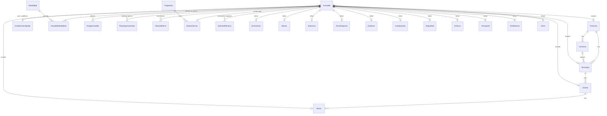

# Models, dependencies and business rules

Reference for the Django models in `backend/base/models/`. It describes what exists today; the history
and the remaining tasks are in [TODO.md](TODO.md). Every model lives in the `base` app. Field names are
Spanish; money is in euros.

How to read the rules: each one says where it is enforced.
**DB** = database constraint, **model** = validator or `clean()`, **admin** = Django admin form,
**API** = serializer or view, **seed** = loaded by the seed tool, **command** = management command.

## 1. Overview

The model groups:

| Group | Models | Public in the API? |
|---|---|---|
| Locations | `Provincia`, `Comarca`, `Municipio`, `Distrito`, `Barrio` | Yes (reference lists, nested in a listing) |
| Offer | `Modalidad`, `InmuebleModalidad`, `CondicionesAlquiler` | Yes |
| Listing | `Inmueble` | Only published listings, only allow-listed columns |
| Detail tables | `Dormitorios`, `Banios`, `Estancias`, `OtrosEspacios`, `Dotacion`, `Instalaciones`, `Seguridad`, `Entorno`, `Transporte`, `AreaRecreo`, `Otros` | Yes |
| Media and parking | `ImageInmueble`, `PlazaAparcamiento` | Yes (parking value and rent are private) |
| Private | `Propietario`, `DatosInternos`, `HistorialRenta` | Never |
| Requests | `SolicitudReserva` | Write-only: the public can create one, never read |

## 2. Dependencies and delete behaviour

Direction: "A → B" means A holds the foreign key to B.

| From | To | On delete of the target |
|---|---|---|
| `Comarca`, `Municipio` → `Provincia` | | `PROTECT` |
| `Municipio` → `Comarca` (optional) | | `PROTECT` |
| `Distrito` → `Municipio`, `Barrio` → `Distrito` | | `PROTECT` |
| `Inmueble` → `Provincia`, `Municipio`, `Distrito`, `Barrio` (all optional) | | `PROTECT` |
| `Inmueble` → `CondicionesAlquiler` (optional) | | `PROTECT` |
| `Inmueble` → user (`created_by`, `updated_by`) | | `SET_NULL` |
| `InmuebleModalidad` → `Inmueble` | | `CASCADE` (a listing's prices go with it) |
| `InmuebleModalidad` → `Modalidad` | | `PROTECT` (a modalidad in use cannot be deleted) |
| `ImageInmueble`, `PlazaAparcamiento`, `HistorialRenta`, `DatosInternos` → `Inmueble` | | `CASCADE` |
| Every detail table → `Inmueble` (one-to-one, field `inmueble`) | | `CASCADE` |
| `DatosInternos` → `Propietario` (optional) | | `PROTECT` (an owner with listings cannot be deleted) |
| `SolicitudReserva` → `Inmueble` (optional) | | `SET_NULL` (the request survives its listing) |

Consequences: you cannot delete a location, a modalidad in use, a conditions record in use or an owner with
listings until the things that point at them are changed. Deleting a listing removes its prices, photos,
parking spaces, rent history, internal data and detail rows, but keeps its reservation requests.

## 3. Locations (`ubicacion.py`)

Hierarchy: `Provincia` → `Municipio` (also optionally in a `Comarca`) → `Distrito` → `Barrio`.

| Model | Key fields | Rules |
|---|---|---|
| `Provincia` | `codigo_ine` (2 digits), `nombre`, `slug` | `codigo_ine`, `nombre` and `slug` unique (DB) |
| `Comarca` | `provincia`, `codigo`, `nombre`, `slug` | `codigo` and `slug` unique within the province (DB) |
| `Municipio` | `provincia`, `comarca`, `codigo_ine` (5 digits: province + municipality), `nombre`, `slug`, `latitud`, `longitud` | `codigo_ine` unique; `slug` unique within the province (DB) |
| `Distrito` | `municipio`, `codigo`, `nombre`, `slug` | `codigo` and `slug` unique within the municipality (DB); ordered by `codigo` |
| `Barrio` | `distrito`, `codigo`, `nombre`, `slug` | `codigo` and `slug` unique within the district (DB); ordered by `codigo` |

- `slug` is filled from `nombre` on save when left empty (model).
- Loaded by the seed tool: 1 province, 14 comarcas, 311 municipios, 10 Barcelona districts and 73 barrios
  (seed). Districts and barrios of other cities are not loaded yet.

## 4. Offer: `Modalidad`, `InmuebleModalidad`, `CondicionesAlquiler`

### `Modalidad` (seed)
Kind of offer. Three rows: `temporal`, `habitual`, `venta`.

| Field | Rule |
|---|---|
| `codigo` | Unique slug (DB) |
| `nombre`, `orden` | Display name and sort order |
| `unidad_precio` | `mensual` or `total`: the unit of the price of this modalidad. Temporal and habitual are monthly, venta is a total |

### `InmuebleModalidad` (listing ↔ modalidad, with the price)
One row per modalidad a listing is offered under. This is the only place prices live.

| Rule | Where |
|---|---|
| `precio` is required | DB |
| `precio` cannot be negative | DB constraint + model validator |
| A listing has each modalidad at most once | DB (`inmueble`, `modalidad` unique) |
| A listing must have at least one modalidad with its price | admin (inline with `min_num=1`) |
| A modalidad in use cannot be deleted | DB (`PROTECT`) |

Because the price is required, a listing offered for sale always has a sale price, and a rental always has a
rent price. The API returns `modalidades: [{codigo, nombre, unidad_precio, precio}]` and keeps two derived
fields for the frontend: `importe_venta` (the venta price) and `importe_alquiler` (the lowest monthly price).

### `CondicionesAlquiler`
Contracting conditions as text: `fianza`, `honorarios`, `pago_adelantado`, `itp`, `suministros`,
`limpieza_final`, `incluido`, `no_incluido`.

- Only one record can have `por_defecto=True` (DB, conditional unique constraint).
- A listing uses its own `condiciones`; when empty the API returns the default record (API). If no default
  exists, the field is `null`.

## 5. The listing: `Inmueble`

Primary key `_id`; `referencia` is unique. Main groups of columns:

| Group | Columns |
|---|---|
| Identity | `referencia`, `original_id` (id in the legacy system), `titulo`, `tipo`, `estado` |
| Location | `provincia`, `municipio`, `distrito`, `barrio`, `codigo_postal`, `direccion`, `direccion_short`, `dir_descripcion`, `geo_latitude`, `geo_longitude` |
| Dates | `fecha_disponibilidad`, `fecha_alta`, `fecha_baja`, `fecha_entrega` (all dates, no time) |
| Surfaces (m²) | `sup_construida`, `sup_cont_comun`, `sup_util` |
| Costs | `gtos_comunidad`, `ibi`, `ibi_incluido` |
| Energy | `eficiencia`, `nombre_eficiencia`, `consumo_energetico` (kWh/m²/year) |
| Catalan rental rules | `ultima_renta`, `indice_referencia_min`, `indice_referencia_max`, `actualizacion_renta`, `situacion_5_anios`, `gran_tenedor`, `zona_tensionada`, `condiciones` |
| Web | `publicar_web`, `descripcion_es`, `descripcion_en`, `descripcion_cat`, `usos`, `notas_web`, `matterport_url`, `cedula`, `situacion_actual` |
| Audit | `created_at`, `updated_at`, `created_by`, `updated_by` |

Choices: `tipo` is Vivienda, Oficina, Local, Parking or Otro (default Otro); `estado` is Disponible,
Alquilado or Reservado (default Disponible).

### Rules

| Rule | Where |
|---|---|
| `referencia` is unique | DB |
| The municipio must belong to the provincia, the distrito to the municipio, and the barrio to the distrito (and to the municipio) | model `clean()` (admin) |
| `indice_referencia_min` ≤ `indice_referencia_max` | DB constraint + model `clean()` |
| `sup_construida`, `sup_cont_comun`, `sup_util`, `gtos_comunidad`, `ibi`, `ultima_renta`, both reference indices and `consumo_energetico` cannot be negative | DB constraint + model validator |
| Surfaces allow up to 999,999.99 m² | DB |
| A new listing is not published (`publicar_web=False`) | model default |
| `created_by` is set on creation and `updated_by` on every save, from the logged-in user | admin (`save_model`) |
| Text columns are never NULL; the empty state is `''` | DB |

### Derived values (computed, not stored)

| Value | Definition |
|---|---|
| `n_habitaciones` | `Dormitorios.dobles + individuales + suites` (`exteriores` is not extra rooms); 0 without a `Dormitorios` row. The `habitaciones` search filter uses the same sum in SQL |
| `n_plz_garaje` (API, detail) | Number of `PlazaAparcamiento` rows |
| `zona` (API) | Name of the barrio, else of the distrito |
| `zona_ref` (API) | Name of the distrito |
| `n_banios` (API) | `Banios.banios`, 0 without a `Banios` row |
| `es_venta` (API) | The listing has the venta modalidad |
| `importe_venta`, `importe_alquiler` (API) | See section 4 |

## 6. Detail tables

Each has at most one row per listing (one-to-one, field `inmueble`) and is deleted with the listing. All
counts are `PositiveIntegerField` (never negative, DB). All are public in the API.

| Model | Contents |
|---|---|
| `Dormitorios` | `dobles`, `individuales`, `exteriores`, `suites` |
| `Banios` | `banios` (count), `suelo` |
| `Estancias` | Living room (`salon`), terrace and balconies (`terraza`, `balcones`), kitchen (`cocina`, `cocina_amueblada`, `tipo_cocina`, `suelo_cocina`), carpentry (`carpinteria_interior`, `carpinteria_exterior`) and one shared `descripcion`. The API still returns it as four blocks: `salon`, `terraza`, `cocina`, `carpinteria` |
| `OtrosEspacios` | Counts of `despachos`, `vestidores`, `altillo`, `galeria`, `trastero`, `buhardilla`, `bodega`, `lavadero`, `estudios`, `bibliotecas` |
| `Dotacion` | `amueblado`, `utensilios_cocina` and counts of appliances and furniture (lavadora, nevera, camas, sofás...) |
| `Instalaciones` | Water, electricity and gas (meter and company), heating, TV, internet, phone, air conditioning, `ascensor` (count), `acceso_silla_ruedas`... |
| `Seguridad` | Doorman, private security, cameras, armoured door, safe, armoured glass, alarm, anti-theft, fire protection, video entry, automatic door |
| `Entorno` | Garden, community areas, `cerca_*` flags for services, `distancia_playa_m`, `distancia_poblacion_m`, `distancia_ciudad_m` (metres, may be unknown) |
| `Transporte` | `cerca_*` flag plus `descripcion_*` for bus, metro, tranvía, tren, ferrocarril |
| `AreaRecreo` | Sports area, gym, pool, solarium, children's garden, social room |
| `Otros` | `capacidad_personas`, `suelo_piso`, `exterior`, `altura_real_m`, `anio_ultima_reforma`, `gastos_comunidad_incluidos`, `orientacion`, `chimenea`, views, `tipo_fachada`, `office`, `acepta_animales`, `estancia_minima_meses`, `estancia_maxima_meses` |

Equipment and stay limits live **only** in these tables, never on `Inmueble`.

## 7. Photos and parking

### `ImageInmueble`
| Field | Rule |
|---|---|
| `inmueble` | Required (a photo always belongs to a listing) |
| `image` | `ImageField`, stored under `<inmueble id>/<file name>` |
| `posicion` | Display order; photos sort by `posicion`, then creation |
| `alt_text` | Alternative text for accessibility |
| `default` | At most one default photo per listing (DB, conditional unique constraint) |

### `PlazaAparcamiento` (many per listing)
A parking space that belongs to another listing, such as a flat with two spaces. A parking space that is sold
or let on its own is a listing with `tipo='Parking'` and is priced through `InmuebleModalidad`.

| Field | Rule |
|---|---|
| `numero` | Unique within the listing when filled in (DB); several unnumbered spaces are allowed |
| `tipo` | `coche` (default) or `moto` |
| `superficie` | m², cannot be negative (model) |
| `valor`, `renta` | Private: never in the API; cannot be negative (model) |
| `notas` | Free text |

A `tipo='Parking'` listing may also have plaza rows; it is optional.

## 8. Private data (never in the API)

| Model | Purpose and rules |
|---|---|
| `Propietario` | Owner: `nombre`, `nif`, `email`, `telefono`. An owner with listings cannot be deleted (`PROTECT`) |
| `DatosInternos` | One per listing: `propietario` (optional), `notas_internas`, `otros_datos`, `cat_nrc` (cadastral reference), `fecha_firma` |
| `HistorialRenta` | Rent by date for a listing: `fecha`, `importe` (≥ 0, model validator), `nota`; one entry per date per listing (DB); newest first. `ultima_renta` on `Inmueble` stays the public declared figure |
| `Inmueble` columns | `original_id`, `publicar_web`, `fecha_baja`, `fecha_entrega`, `created_at`, `updated_at`, `created_by`, `updated_by` |

Public exposure is an allow-list: a new `Inmueble` column stays private until it is added to the public list
in `serializers.py`. A test fails until every column is classified as public or private, and another checks
that private values never appear in a detail response.

## 9. Reservation requests: `SolicitudReserva`

Created from the public API (`POST /api/inmuebles/<id>/reservas/`). In the admin every field is read only
except `estado`.

| Field | Rule |
|---|---|
| `inmueble` | Optional link; `SET_NULL` when the listing is deleted |
| `referencia` | Copy of the listing's reference at the time of the request |
| `nombre`, `email`, `telefono`, `fecha_desde` | Data given by the visitor |
| `acepta_aviso_legal` | Must be true (API validation and model `clean()`) |
| `estado` | `pendiente` (default), `contactada`, `cerrada` or `descartada`; the client cannot set it, staff change it in the admin |
| `datos_borrados` | When the personal data was blanked |

| Rule | Where |
|---|---|
| Only published listings accept requests | API (404 otherwise) |
| At most 10 requests per hour per client | API (throttle) |
| Personal data is kept 12 months: `python manage.py purgar_solicitudes` blanks `nombre`, `email` and `telefono` on older requests and keeps the rest of the row. Options `--meses N`, `--dry-run`; safe to repeat | command (to be scheduled, e.g. cron) |

## 10. What the public API returns

- `GET /api/inmuebles/` and `.../modalidad/<temporales|habituales|ventas>/`: published listings only,
  5 per page, with a subset of the nested data.
- `GET /api/inmuebles/<id>/`: one published listing with all the public columns and every public nested
  block (locations, modalidades with prices, detail tables, plazas, photos, conditions).
- Search filters: `provincia`, `municipio`, `distrito`, `barrio`, `referencia`, `habitaciones` (exact
  computed count), `max_precio`, `fecha_entrada` (available on or before that date). A non-numeric value
  returns 400.
- `max_precio` compares the price of the modalidad in the URL (the sale price on `ventas`); on
  `inmuebles/` without a modalidad it compares the monthly (rent) prices. A listing appears once.
- Reference lists: provinces, municipios, distritos, barrios, modalidades (with `unidad_precio`).
