# Models, dependencies and business rules

Reference for the Django models in `backend/base/models/`. It describes what exists today. Every model lives in the `base` app. Field names are
Spanish; money is in euros.

How to read the rules: each one says where it is enforced.
**DB** = database constraint, **model** = validator or `clean()`, **admin** = Django admin form,
**API** = serializer or view, **seed** = loaded by the seed tool, **command** = management command.

## 1. Overview

```mermaid
erDiagram
    Provincia ||--o{ Comarca : has
    Provincia ||--o{ Municipio : has
    Comarca |o--o{ Municipio : groups
    Municipio ||--o{ Distrito : has
    Municipio ||--o{ DeclaracionZonaTensionada : "declared stressed"
    Distrito ||--o{ Barrio : has

    Inmueble }o--|| Municipio : located
    Inmueble }o--o| Distrito : located
    Inmueble }o--o| Barrio : located

    Inmueble ||--|{ InmuebleModalidad : "offered as (price)"
    Modalidad ||--o{ InmuebleModalidad : "used by"
    Modalidad ||--o{ Condiciones : "conditions of"
    InmuebleModalidad }o--o| Condiciones : "own conditions"
    Inmueble ||--o{ HistorialPrecio : "price history"
    Modalidad ||--o{ HistorialPrecio : "of"

    Inmueble ||--o{ ImageInmueble : "photos and plans"
    Inmueble ||--o{ MediaInmueble : "videos and tours"
    Inmueble ||--o{ PlazaAparcamiento : "parking spaces"
    Inmueble ||--o{ RegistroLegal : "registry numbers"
    Inmueble ||--o| DatosInternos : "private data"
    Inmueble ||--o{ InmueblePropietario : "owned by"
    Propietario ||--o{ InmueblePropietario : owns
    Inmueble ||--o{ SolicitudReserva : "requests (reservation, visit, information)"

    Inmueble ||--o| Dormitorios : detail
    Inmueble ||--o| Banios : detail
    Inmueble ||--o| Estancias : detail
    Inmueble ||--o| OtrosEspacios : detail
    Inmueble ||--o| Dotacion : detail
    Inmueble ||--o| Instalaciones : detail
    Inmueble ||--o| Seguridad : detail
    Inmueble ||--o| Entorno : detail
    Inmueble ||--o| Transporte : detail
    Inmueble ||--o| AreaRecreo : detail
    Inmueble ||--o| Otros : detail
```

The model groups:

| Group | Models | Public in the API? |
|---|---|---|
| Locations | `Provincia`, `Comarca`, `Municipio`, `Distrito`, `Barrio` | Yes (reference lists, nested in a listing) |
| Offer | `Modalidad`, `InmuebleModalidad`, `Condiciones` | Yes |
| Listing | `Inmueble` | Only published listings, only allow-listed columns |
| Detail tables | `Dormitorios`, `Banios`, `Estancias`, `OtrosEspacios`, `Dotacion`, `Instalaciones`, `Seguridad`, `Entorno`, `Transporte`, `AreaRecreo`, `Otros` | Yes |
| Media and parking | `ImageInmueble`, `MediaInmueble`, `PlazaAparcamiento` | Yes (parking value and rent are private; the optional price is public) |
| Legal | `RegistroLegal` | Yes |
| Private | `Propietario`, `InmueblePropietario`, `DatosInternos`, `HistorialPrecio`, `DeclaracionZonaTensionada` | Never (the detail shows only `gran_tenedor` and `zona_tensionada`, derived) |
| Requests | `SolicitudReserva` | Write-only: the public can create one, never read |

## 2. Dependencies and delete behaviour

Direction: "A → B" means A holds the foreign key to B.

| From | To | On delete of the target |
|---|---|---|
| `Comarca`, `Municipio` → `Provincia` | | `PROTECT` |
| `Municipio` → `Comarca` (optional) | | `PROTECT` |
| `Distrito` → `Municipio`, `Barrio` → `Distrito` | | `PROTECT` |
| `Inmueble` → `Municipio` (required), `Distrito`, `Barrio` (optional) | | `PROTECT` |
| `InmuebleModalidad` → `Condiciones` (optional) | | `PROTECT` (conditions in use cannot be deleted) |
| `Condiciones` → `Modalidad` | | `PROTECT` |
| `HistorialPrecio` → `Modalidad` | | `PROTECT` |
| `Inmueble` → user (`created_by`, `updated_by`) | | `SET_NULL` |
| `InmuebleModalidad` → `Inmueble` | | `CASCADE` (a listing's prices go with it) |
| `InmuebleModalidad` → `Modalidad` | | `PROTECT` (a modalidad in use cannot be deleted) |
| `ImageInmueble`, `MediaInmueble`, `PlazaAparcamiento`, `RegistroLegal`, `HistorialPrecio`, `DatosInternos` → `Inmueble` | | `CASCADE` |
| Every detail table → `Inmueble` (one-to-one, field `inmueble`) | | `CASCADE` |
| `InmueblePropietario` → `Inmueble` | | `CASCADE` |
| `InmueblePropietario` → `Propietario` | | `PROTECT` (an owner with listings cannot be deleted) |
| `SolicitudReserva` → `Inmueble` (optional) | | `SET_NULL` (the request survives its listing) |

Consequences: you cannot delete a location, a modalidad in use, a conditions record in use or an owner with
listings until the things that point at them are changed. Deleting a listing removes its prices, photos,
parking spaces, rent history, internal data and detail rows, but keeps its reservation requests.

## 3. Locations (`ubicacion.py`)

Hierarchy: `Provincia` → `Municipio` (also optionally in a `Comarca`) → `Distrito` → `Barrio`.

| Model | Key fields | Rules |
|---|---|---|
| `Provincia` | `codigo_ine` (2 digits), `nombre`, `slug` | `codigo_ine`, `nombre` and `slug` unique (DB) |
| `Comarca` | `provincia`, `codigo`, `nombre`, `slug` | `codigo` and `slug` unique within the province (DB) |
| `Municipio` | `provincia`, `comarca`, `codigo_ine` (5 digits: province + municipality), `nombre`, `slug`, `latitud`, `longitud` | `codigo_ine` unique; `slug` unique within the province (DB) |
| `Distrito` | `municipio`, `codigo`, `nombre`, `slug` | `codigo` and `slug` unique within the municipality (DB); ordered by `codigo` |
| `Barrio` | `distrito`, `codigo`, `nombre`, `slug` | `codigo` and `slug` unique within the district (DB); ordered by `codigo` |

- `slug` is filled from `nombre` on save when left empty (model).
- A `Municipio` code must start with its province's code, and its `comarca` must be in the same province (model, checked on every save).
- The province of a listing is not stored: `Inmueble.provincia` is a property (`municipio.provincia`). The API still returns `provincia`, and the `provincia` filter matches `municipio__provincia`.
- Loaded by the seed tool: 1 province, 14 comarcas, 311 municipios, 10 Barcelona districts and 73 barrios
  (seed). Districts and barrios of other cities are not loaded yet.

## 4. Offer: `Modalidad`, `InmuebleModalidad`, `Condiciones`

### `Modalidad` (seed)
Kind of offer. Three rows: `temporal`, `habitual`, `venta`.

| Field | Rule |
|---|---|
| `codigo` | Unique slug (DB) |
| `nombre`, `orden` | Display name and sort order |
| `unidad_precio` | `mensual` or `total`: the unit of the price of this modalidad. Temporal and habitual are monthly, venta is a total |

### `InmuebleModalidad` (listing ↔ modalidad, with the price)
One row per modalidad a listing is offered under. This is the only place prices live.

| Rule | Where |
|---|---|
| `precio` is required | DB |
| `precio` cannot be negative | DB constraint + model validator |
| A listing has each modalidad at most once | DB (`inmueble`, `modalidad` unique) |
| A listing must have at least one modalidad with its price | admin (inline with `min_num=1`) |
| A modalidad in use cannot be deleted | DB (`PROTECT`) |
| `mas_iva` says the price excludes VAT; `tipo_iva` (0–100 %) is then required, and must be empty without `mas_iva` | DB constraint + model `clean()` |
| `condiciones` (optional) must be conditions of the same modalidad | model `clean()` and `save()` |
| `estado` of the offer: `disponible` (default), `reservado` or `cerrado` (rented or sold) | DB choices + model validator |

The availability of a listing is not stored: `Inmueble.estado` is derived from its offers and returned in the list
and the detail. `Disponible` if any offer is `disponible` (or there are no offers); else `Reservado` if any is
`reservado`; when every offer is `cerrado`, `Alquilado` if one of them has a monthly price, else `Vendido`. So a
flat that is let but still for sale stays `Disponible`. The list is ordered by this state (available, reserved,
closed), then by `fecha_disponibilidad`.

Because the price is required, a listing offered for sale always has a sale price, and a rental always has a
rent price. `precio` is always the amount as advertised: with `mas_iva` it is the net price. The API returns
`modalidades: [{codigo, nombre, unidad_precio, precio, mas_iva, tipo_iva}]` (the detail adds `ultima_renta` and `condiciones`)
and keeps two derived fields for the frontend: `importe_venta` (the venta price) and `importe_alquiler` (the
lowest monthly price), both as stored, without VAT added.

`ultima_renta` (the rent the regulation asks to show) is not a column: it is the monthly price charged before the
current one, for that modalidad, read from `HistorialPrecio` (rows dated in the future are ignored). It is `null`
when there is no earlier price and always `null` for sale. It is returned in each detail `modalidades` entry, so a
listing offered under two rental modalidades has one per modalidad. The history itself is never serialized.

### `Condiciones`
Contracting conditions of one modalidad (`modalidad`, required), as text.

| Group | Fields |
|---|---|
| Rent and sale | `honorarios`, `itp`, `incluido`, `no_incluido` |
| Rent | `fianza`, `pago_adelantado`, `suministros`, `limpieza_final`, `requisitos` (documents the tenant must supply) |
| Sale | `notaria`, `registro`, `gestoria`, `honorarios_comprador` (costs on top of the price) |

- Each modalidad has at most one record with `por_defecto=True` (DB, conditional unique constraint).
- A listing chooses its own conditions per price (`InmuebleModalidad.condiciones`, same modalidad). When empty
  the API returns the default record of that modalidad (API); with no default the field is `null`. This lets
  a listing offered for rent and for sale carry different conditions for each.
- The defaults are read once per request, so the number of queries does not grow with the modalidades.

## 5. The listing: `Inmueble`

Primary key `_id`; `referencia` is unique. Main groups of columns:

| Group | Columns |
|---|---|
| Identity | `referencia`, `original_id` (id in the legacy system), `titulo`, `tipo`, `subtipo` |
| Building | `conservacion`, `anio_construccion`, `planta` (floor of a flat), `n_plantas` (levels of the property) |
| Location | `municipio`, `distrito`, `barrio`, `codigo_postal`, `direccion`, `direccion_short`, `dir_descripcion`, `ocultar_direccion`, `geo_latitude`, `geo_longitude` |
| Dates | `fecha_disponibilidad`, `fecha_alta`, `fecha_baja`, `fecha_entrega` (all dates, no time) |
| Surfaces (m²) | `sup_construida`, `sup_cont_comun`, `sup_util`, `sup_parcela` (plot) |
| Costs | `gtos_comunidad`, `ibi` (whether they are included in the rent is `Otros.gastos_comunidad_incluidos` and `Otros.ibi_incluido`) |
| Energy | `eficiencia`, `nombre_eficiencia`, `consumo_energetico` (kWh/m²/year), `emisiones_co2` (kg CO₂/m²/year) |
| Catalan rental rules | `indice_referencia_min`, `indice_referencia_max`, `actualizacion_renta`, `situacion_5_anios`. `zona_tensionada` and `gran_tenedor` are not columns: `gran_tenedor` is a property of the owner (`Propietario.gran_tenedor`) and the detail returns `true` when any owner of the listing has it; `zona_tensionada` comes from the municipality's declarations (section 3) and is `true` when one is in force today |
| Web | `publicar_web`, `descripcion_es`, `descripcion_en`, `descripcion_cat`, `usos`, `notas_web`, `situacion_actual` |
| Audit | `created_at`, `updated_at`, `created_by`, `updated_by` |

Choices: `tipo` is Vivienda, Oficina, Local, Parking or Otro (default Otro); `conservacion` is obra nueva,
buen estado or a reformar (it is not the availability `estado`, which lives on each offer, see section 4).

### Rules

| Rule | Where |
|---|---|
| `referencia` is unique | DB |
| `municipio` is required; the distrito must belong to the municipio, and the barrio to the distrito (or, without a distrito, to the municipio) | model `validate_location()`, run by `clean()` and every `save()` |
| `indice_referencia_min` ≤ `indice_referencia_max` | DB constraint + model `clean()` |
| `subtipo` is one of piso, ático, dúplex, estudio, chalet adosado, chalet independiente, otro, and only a `Vivienda` has one (any other `tipo` needs it empty) | DB constraint + model `clean()` and `save()` |
| `anio_construccion` is 1000–2100, `planta` is -5–100 (0 is the ground floor, negative a basement), `n_plantas` is 1–100 | DB constraint + model validator |
| `sup_construida`, `sup_cont_comun`, `sup_util`, `sup_parcela`, `gtos_comunidad`, `ibi`, both reference indices, `consumo_energetico` and `emisiones_co2` cannot be negative | DB constraint + model validator |
| Surfaces allow up to 999,999.99 m² | DB |
| A new listing is not published (`publicar_web=False`) | model default |
| `created_by` is set on creation and `updated_by` on every save, from the logged-in user | admin (`save_model`) |
| Text columns are never NULL; the empty state is `''` | DB |
| With `ocultar_direccion` the API returns `direccion`, `direccion_short` and `dir_descripcion` as `''` (detail and list). The coordinates and postal code are still returned | API |

### Derived values (computed, not stored)

| Value | Definition |
|---|---|
| `n_habitaciones` | `Dormitorios.dobles + individuales` (`suites` and `exteriores` are subsets, not extra rooms); 0 without a `Dormitorios` row. The `habitaciones` search filter uses the same sum in SQL |
| `n_plz_garaje` (API, detail) | Number of `PlazaAparcamiento` rows |
| `zona` (API) | Name of the barrio, else of the distrito |
| `zona_ref` (API) | Name of the distrito |
| `n_banios` (API) | `Banios.banios`, 0 without a `Banios` row |
| `es_venta` (API) | The listing has the venta modalidad |
| `importe_venta`, `importe_alquiler` (API) | See section 4 |

## 6. Detail tables

Each has at most one row per listing (one-to-one, field `inmueble`) and is deleted with the listing. All
counts are `PositiveIntegerField` (never negative, DB). All are public in the API.

| Model | Contents |
|---|---|
| `Dormitorios` | `dobles`, `individuales`, `exteriores`, `suites`. `suites` counts how many of the bedrooms have their own bathroom, so it cannot exceed `dobles + individuales` (DB) |
| `Banios` | `banios` (count), `suelo` |
| `Estancias` | Living room area (`salon_m2`), terraces and balconies as a count plus an area each (`terraza`, `terraza_m2`, `balcones`, `balcones_m2`; areas in m², not negative), kitchen (`cocina`, `cocina_amueblada`, `tipo_cocina`, `suelo_cocina`), carpentry material as text (`carpinteria_interior`, `carpinteria_exterior`, e.g. Madera, Aluminio) and one shared `descripcion`. The API still returns it as four blocks: `salon`, `terraza`, `cocina`, `carpinteria` |
| `OtrosEspacios` | Counts of `despachos`, `vestidores`, `altillo`, `galeria`, `trastero`, `buhardilla`, `bodega`, `lavadero`, `estudios`, `bibliotecas` |
| `Dotacion` | `amueblado`, `utensilios_cocina`, `vajilla`, `cuberteria`, `cristaleria`, `ropa_cama`, `toallas` and counts of appliances and furniture (lavadora, nevera, camas, sofás...) |
| `Instalaciones` | Water, electricity and gas (meter and company), heating, TV, internet, phone, air conditioning, `ascensor` (count), `acceso_silla_ruedas`... |
| `Seguridad` | Doorman, private security, cameras, armoured door, safe, armoured glass, alarm, anti-theft, fire protection, video entry, automatic door |
| `Entorno` | Garden (`jardin`, and its area `jardin_m2` in m², only with a garden), community areas, `cerca_*` flags for services, `distancia_playa_m`, `distancia_poblacion_m`, `distancia_ciudad_m` (metres, may be unknown) |
| `Transporte` | `cerca_*` flag plus `descripcion_*` for bus, metro, tranvía, tren, ferrocarril |
| `AreaRecreo` | Sports area, gym, pool, solarium, children's garden, social room |
| `Otros` | `capacidad_personas`, `suelo_piso`, `exterior` (yes/no), `altura_real_m`, `anio_ultima_reforma`, `gastos_comunidad_incluidos`, `ibi_incluido`, `orientacion`, `chimenea`, views, `tipo_fachada`, `office`, `acepta_animales`, stay limits (below) |

Equipment and stay limits live **only** in these tables, never on `Inmueble`.

Stay limits are a number plus a unit: `estancia_minima` / `estancia_minima_unidad` and `estancia_maxima` /
`estancia_maxima_unidad`, with units `dias`, `meses` (default) or `anios`. Either limit can be empty. The
minimum cannot exceed the maximum once both are converted to days (30 per month, 365 per year) (DB + model
`clean()`).

## 7. Photos, videos and parking

### `ImageInmueble`
| Field | Rule |
|---|---|
| `inmueble` | Required (a photo always belongs to a listing) |
| `image` | `ImageField`, stored under `<inmueble id>/<file name>` |
| `posicion` | Display order; photos sort by `posicion`, then creation |
| `alt_text` | Alternative text for accessibility |
| `tipo` | What it shows: `fachada`, `salon`, `cocina`, `dormitorio`, `banio`, `terraza`, `jardin`, `vistas`, `plano` or `otro` (default) |
| `default` | At most one default photo per listing (DB, conditional unique constraint); a `plano` can never be the default (DB) |

Floor plans are images with `tipo='plano'`. The API returns them apart: `images` holds the photos and the
detail adds `planos`, so a plan never appears among the photos.

### `MediaInmueble` (many per listing)
Videos and virtual tours, by link. Replaces `Inmueble.matterport_url`.

| Field | Rule |
|---|---|
| `tipo` | `video` (default) or `tour` |
| `url` | A valid link, up to 500 characters; each link appears once per listing (DB) |
| `titulo` | Optional label |
| `posicion` | Display order, then creation |

The detail returns `medios: [{tipo, url, titulo}]`. Deleted with the listing.

### `PlazaAparcamiento` (many per listing)
A parking space that belongs to another listing, such as a flat with two spaces. A parking space that is sold
or let on its own is a listing with `tipo='Parking'` and is priced through `InmuebleModalidad`.

| Field | Rule |
|---|---|
| `numero` | Unique within the listing when filled in (DB); several unnumbered spaces are allowed |
| `tipo` | `coche` (default) or `moto` |
| `superficie` | m², cannot be negative (model) |
| `valor`, `renta` | Private: never in the API; cannot be negative (model) |
| `notas` | Free text |
| `opcional` | The space can be added for an extra price |
| `precio_opcional`, `precio_opcional_unidad` | Public price of an optional space and its unit (`mensual` default, or `total`); only with `opcional` (DB), not negative (DB) |
| `precio_opcional_mas_iva`, `precio_opcional_tipo_iva` | Same VAT rule as `InmuebleModalidad`: the rate is required with `mas_iva` and empty without it (DB + model) |

A `tipo='Parking'` listing may also have plaza rows; it is optional.

### `RegistroLegal` (many per listing)
Registration or licence numbers a listing must show. Not tied to one region: each row says its type and the
issuing body, so other provinces can use their own registries.

| Field | Rule |
|---|---|
| `tipo` | `aicat`, `cedula_habitabilidad`, `certificado_energetico`, `licencia_turistica` or `otro` |
| `numero` | The registry number as printed (may be masked, e.g. `CHB0333*******`). May be empty when the listing has the registration but the advert does not publish the number (a tourist licence, in idealista-03) |
| `organismo` | Issuing body, free text (optional) |

- Each type appears at most once per listing, except `otro` which can repeat (DB, conditional unique constraint).
- Deleted with the listing. Returned in the detail as `registros_legales: [{tipo, numero, organismo}]`.
- Replaces `Inmueble.cedula` (copied into a `cedula_habitabilidad` row by migration `0004`).

## 8. Private data (never in the API)

| Model | Purpose and rules |
|---|---|
| `Propietario` | Owner, independent of any listing: `nombre`, `nif`, `email`, `telefono`, `gran_tenedor` (large holder; applies to all their listings). An owner with listings cannot be deleted (`PROTECT`) |
| `InmueblePropietario` | Link between a listing and an owner (many to many): optional `porcentaje` (share, above 0 and up to 100, DB); an owner appears once per listing (DB). Removed with the listing |
| `DatosInternos` | One per listing: `notas_internas`, `otros_datos`, `cat_nrc` (cadastral reference), `fecha_firma`, and how the agency works the listing: `exclusiva`, `gestion_comercial`, `administracion` (three independent yes/no flags) and `tasacion_propietario` (the owner's valuation, not negative, DB) |
| `DeclaracionZonaTensionada` | Municipality declared a stressed residential market for a period: `municipio` (`PROTECT`), `desde`, `hasta` (empty = still in force, never before `desde`, DB), `referencia` (resolution). One per municipality and start date (DB). `Municipio.es_zona_tensionada()` is true when one is in force on the date; overlaps are allowed. Staff maintain it in the admin; nothing is seeded |
| `HistorialPrecio` | Price by date for a listing under one `modalidad` (rent or sale): `fecha`, `importe` (≥ 0, model validator), `nota`; one entry per modalidad and date per listing (DB); newest first. Rows are appended automatically when an `InmuebleModalidad` price is created or changed (`save()`; a second change on the same day replaces the day's row; `QuerySet.update()` and `bulk_create()` skip it), so the latest row equals the current price. Rows can also be entered by hand, for example past prices. Private, except that the previous monthly price becomes the public `ultima_renta` (see section 4). A modalidad with history cannot be deleted (`PROTECT`) |
| `Inmueble` columns | `original_id`, `publicar_web`, `fecha_baja`, `fecha_entrega`, `created_at`, `updated_at`, `created_by`, `updated_by` |

Public exposure is an allow-list: a new `Inmueble` column stays private until it is added to the public list
in `serializers.py`. A test fails until every column is classified as public or private, and another checks
that private values never appear in a detail response.

## 9. Requests: `SolicitudReserva`

A reservation, a visit or an information request about a listing. The name and the endpoint still say
"reserva"; renaming them is a possible later step. Created from the public API (`POST /api/inmuebles/<id>/reservas/`). In the admin every field is read only
except `estado`.

| Field | Rule |
|---|---|
| `inmueble` | Optional link; `SET_NULL` when the listing is deleted |
| `referencia` | Copy of the listing's reference at the time of the request |
| `tipo` | `reserva` (default, so a request without a type is a reservation), `visita` or `informacion` |
| `nombre`, `email`, `telefono` | Data given by the visitor |
| `fecha_desde` | Optional wanted date: move-in for a reservation, the day of the visit for a visit |
| `mensaje` | Optional free text, up to 2000 characters (API) |
| `acepta_aviso_legal` | Must be true (API validation and model `clean()`) |
| `estado` | `pendiente` (default), `contactada`, `cerrada` or `descartada`; the client cannot set it, staff change it in the admin |
| `datos_borrados` | When the personal data was blanked |

The API accepts `tipo`, `fecha_desde` and `mensaje` besides the name, email, phone and the legal notice.

| Rule | Where |
|---|---|
| Only published listings accept requests | API (404 otherwise) |
| At most 10 requests per hour per client | API (throttle) |
| Personal data is kept 12 months: `python manage.py purgar_solicitudes` blanks `nombre`, `email`, `telefono` and `mensaje` on older requests and keeps the rest of the row. Options `--meses N`, `--dry-run`; safe to repeat | command (to be scheduled, e.g. cron) |

## 10. What the public API returns

- `GET /api/inmuebles/` and `.../modalidad/<temporales|habituales|ventas>/`: published listings only,
  5 per page, with a subset of the nested data.
- `GET /api/inmuebles/<id>/`: one published listing with all the public columns and every public nested
  block (locations, modalidades with prices, VAT and conditions, detail tables, plazas, photos, plans, videos and tours, registry numbers).
- Search filters: `provincia`, `municipio`, `distrito`, `barrio`, `referencia`, `habitaciones` (exact
  computed count), `tipo`, `subtipo`, `sup_min` / `sup_max` (built surface in m²), `max_precio`,
  `fecha_entrada` (available on or before that date). A non-numeric value, or a `tipo` or `subtipo` that
  does not exist, returns 400.
- `max_precio` compares the price of the modalidad in the URL (the sale price on `ventas`); on
  `inmuebles/` without a modalidad it compares the monthly (rent) prices. A listing appears once.
- Reference lists: provinces, municipios, distritos, barrios, modalidades (with `unidad_precio`).
